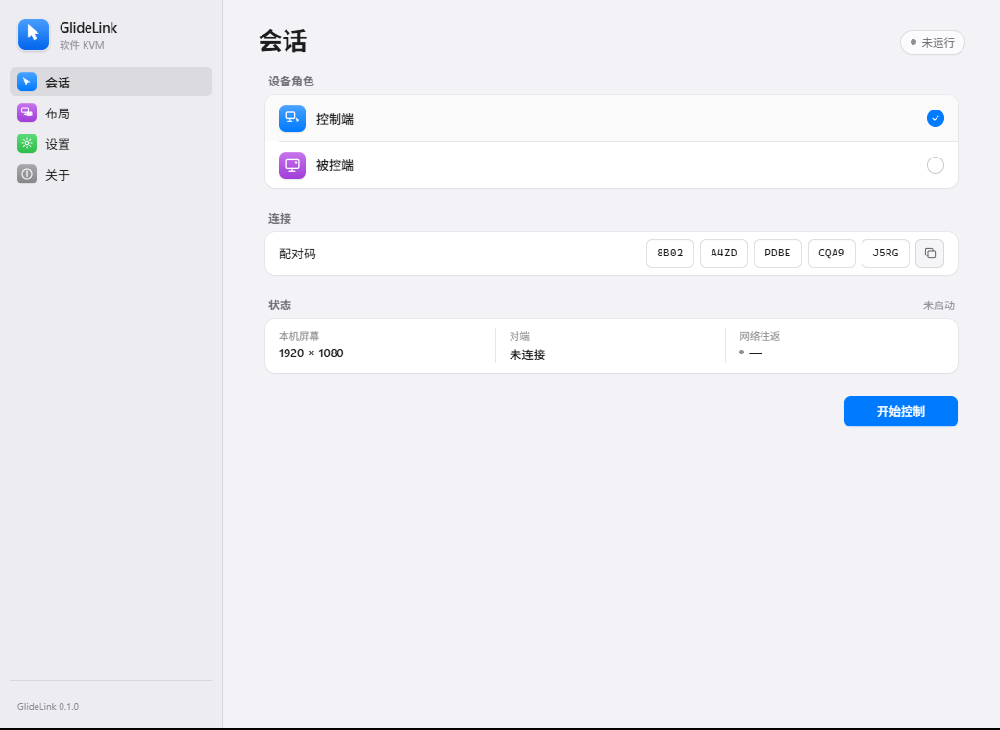

# GlideLink

English | [Chinese](README.md)

Control two computers with one mouse and keyboard. Move the pointer off the screen edge to switch; move it back to return. LAN direct, no drivers or accounts.



## Features

- Mouse movement, buttons, wheel, and keyboard forwarding across the screen edge.
- Keyboard follows the mouse; optional macOS ⌘ ↔ Windows Ctrl mapping.
- Four screen-edge directions, draggable peer arrangement with an edge offset.
- Encrypted session via a 20-character pairing code over LAN UDP.
- Chinese / English; Windows and macOS.

## Build

```bash
cd src-tauri
cargo run              # development
cargo test             # tests
cargo build --release  # release
```

Node.js and a frontend build step are not required.

## Usage

1. Controlled PC: select **Controlled PC**, pick a network interface in **Settings**, click **Start listening**, and send the pairing code to the controller.
2. Controller: select **Controller**, enter the pairing code, place the peer on a screen side in **Layout**, and click **Start controlling**.
3. Move the mouse across that edge to control the other computer; the keyboard follows.

Grant Accessibility and Input Monitoring in macOS System Settings → Privacy & Security.

Settings live in `~/.glidelink/settings.json` (Windows: `C:\Users\<you>\.glidelink\settings.json`).
