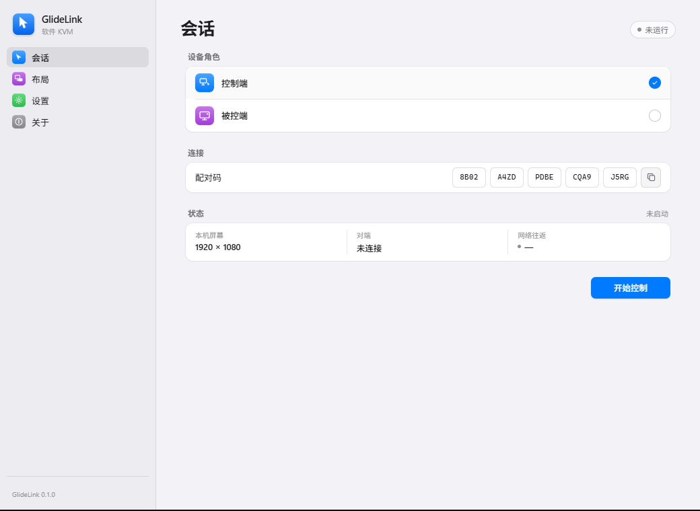

# rx-switch

English | [Chinese](README.md)

Control up to 8 agents with one mouse and keyboard on Windows and macOS. Connections use encrypted TCP over the LAN, with no drivers or accounts.



## Usage

1. Controller: choose a network interface, start listening, and copy the 20-character pairing code.
2. Agent: enter the code and connect. All agents use the same code.
3. Arrange screens in **Display Layout**. Move across touching edges to switch devices; the keyboard follows the pointer.
4. Press `Ctrl + Alt + Backspace` to return control to the local machine.

Initial connection attempts last up to 5 seconds. An established session releases remote input when disconnection is detected and retries for up to 30 seconds, waiting 1 second after each failed attempt. Stop at any time from the window or tray menu. Once the retry window expires, enter the controller's new pairing code to reconnect.

Allow the controller's TCP listening port through the firewall. On macOS, grant Accessibility permission. Treat the pairing code as a connection credential and use it only on trusted LANs.

Closing the window keeps the session running in the tray. On macOS, a monochrome menu-bar icon adapts to the system appearance, and the Dock icon hides while the window is closed. Use the tray menu to restore the window and Dock icon, stop the session, or quit.

rx-switch was previously named GlideLink. Its application identifier and settings directory are retained to preserve permissions, pairing, and layouts. Settings live in `~/.glidelink/settings.json` (Windows: `C:\Users\<you>\.glidelink\settings.json`). The UI provides log viewing, level selection, and copying.

## Development

```bash
cd src-tauri
cargo run
cargo test
cargo build --release
```

No Node.js or frontend build step is needed. See the [architecture](ARCHITECTURE.en.md) for backend details.

Merge feature branches into `dev` following the [development workflow](CONTRIBUTING.md).
