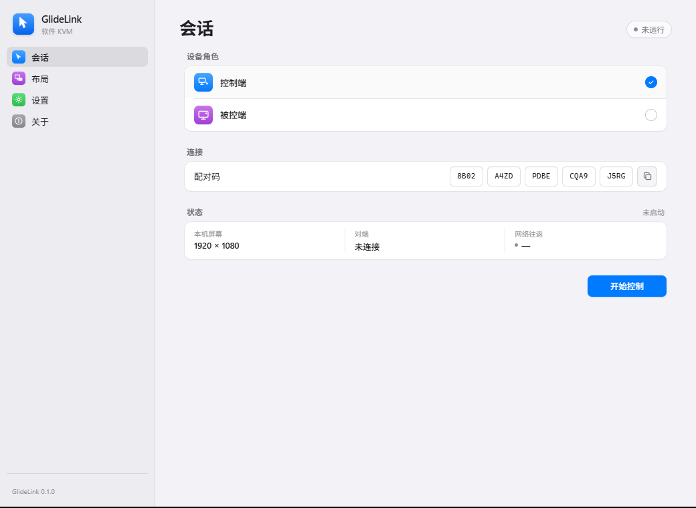

# rx-switch

[English](README.en.md) | 中文

一套键鼠控制多台电脑，支持 Windows 和 macOS。最多连接 8 台被控端，通过加密 TCP 在局域网直连，无需驱动或账号。



## 使用

1. 控制端选择监听网卡，点击「开始监听」，复制 20 位配对码。
2. 被控端输入配对码并连接；多台设备使用同一个码。
3. 在「布局」中排列屏幕，边缘相接即可移动鼠标切换，键盘随鼠标转发。
4. 按 `Ctrl + Alt + Backspace` 强制返回本机。
5. 点击「收起到托盘」可隐藏窗口；默认关闭窗口也会继续运行。通过托盘菜单显示窗口、停止会话或退出，可在「设置 → 窗口」调整关闭行为。

首次连接最多尝试 5 秒；已连接的会话检测到断线后释放远端输入，并保留最多 30 秒自动重连，每次失败后间隔 1 秒重试。期间可随时点击「停止」或使用托盘菜单停止会话。超时后会话自动结束，可重新输入控制端的新配对码。

控制端需放行 TCP 监听端口；macOS 需授予辅助功能权限。配对码等同连接凭证，请只在可信局域网使用并妥善保管。

rx-switch 原名 GlideLink，继续沿用原有应用标识和设置目录以保留权限、配对与布局。设置保存在 `~/.glidelink/settings.json`（Windows：`C:\Users\<用户>\.glidelink\settings.json`）。日志可在界面中查看、调整级别和复制。

## 开发

```bash
cd src-tauri
cargo run
cargo test
cargo build --release
```

无需 Node.js 或前端构建步骤。后端设计见 [架构说明](ARCHITECTURE.md)。

采用功能分支合并到 `dev` 的流程，详见 [开发约定](CONTRIBUTING.md)。
